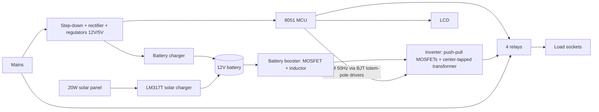

# 500VA Solar-Assisted UPS (12V DC → 220V AC)

A standby UPS with automatic load control, built as my National Diploma: Engineering: Electrical final-year project (Design Project III, DPJ30YT), March 2020. It converts a 12V battery to 220V / 50Hz modified sine wave with an 8051-family microcontroller and power MOSFETs, and charges from mains or a solar panel.

## Why
Load shedding made backup power a daily need. Petrol generators are noisy, polluting and costly to run. This project is a quiet, low-running-cost alternative for small loads such as lights, phone charging and a TV.

## Specifications

| Item | Value |
|---|---|
| Rating | 500VA |
| Input | 12V sealed lead-acid battery (40Ah) |
| Output | 220V AC, 50Hz, modified sine wave |
| Backup time | ~2 hours (design specification, not a measured result) |
| Charging | Mains (12V rectifier + regulator) and 20W polycrystalline solar panel (LM317T charger) |
| Outputs | 4 relay-switched sockets (+4 twin-plug), 2× USB 5V 2A |
| Protection | Per-load overcurrent shut-off, relay flyback diodes, cooling fans |
| Display | LCD battery level |
| Controller | AT89C51 (8051-family) |

## Block diagram

## How it works

- **Mains present:** MCU outputs (pins 32–35) are low, the relay driver transistors are cut off, the relays are de-energised and the loads run from mains. The battery charges.
- **Mains failed:** the MCU outputs go high, the relays energise and the loads run from the inverter. Changeover is relay-based (milliseconds) and the system does not restart.
- **Inverter:** the MCU generates 50Hz drive signals. BC547/BC557 totem-pole drivers switch two N-channel MOSFETs, each on one half of the center-tapped transformer primary. A boost stage (MOSFET, 33µH inductor, diode) lifts the battery voltage slightly so the output reaches 220V.
- **Charging:** the mains charger runs off a 12V rectified and regulated supply. The solar path uses an LM317T with an adjustable output to set the charge voltage.
- **Load protection:** the controller senses current per load and drops the relay of any socket that draws too much.

## Schematics and PCB (Proteus)

| | |
|---|---|
| Power supply | `images/schematics/01-power-supply.png` |
| Solar charging circuit | `images/schematics/02-solar-charging-circuit.png` |
| Inverter and control | `images/schematics/03-inverter-and-control.png` |
| Full system (report versions) | `images/schematics/report-*.png` |
| Boards: power supply, charging, controller, relay | `images/pcb/` (layout, 3D view and artwork) |

## Enclosure
Front panel with LCD, power switch and USB ports; rear panel with load sockets, fans and warning label. See `images/enclosure/`.

## Build photos
Breadboard inverter prototype and the built controller and relay boards: `images/hardware/`.

## Documentation
- `docs/final-group-report.docx`
- `docs/users-manual.docx`
- `docs/pcb-board.docx`, `docs/pcb-layout-artwork.docx`

## Known limitations
- Modified sine wave: not ideal for motors, compressors or sensitive electronics.
- 20W solar is a trickle charger for a 40Ah battery, not a full recharge source.
- No measured test data (output waveform, efficiency, real runtime) was recorded.
- The boost diode is a 1N4007 in the simulation; a fast or Schottky diode suits a switching stage better.
- MOSFETs: IRF3315 appears in the Proteus model; an IRF3205-class device is the better match for ~45A at 12V.

## Possible improvements
- Pure sine wave output (SPWM).
- Bluetooth, Wi-Fi or GSM monitoring and control.
- 24V battery bus for higher power.
- Firmware and test data added to this repo.

## Credits
- Solar charger circuit based on a design from EEEPROJECT.COM.
- Design Project III. Lecturer: Mr E. Malan.

## Author
**Tebogo Mapetla** — Electronics Technician, Embedded Systems and IoT Developer, Pretoria, South Africa.

## License
MIT
